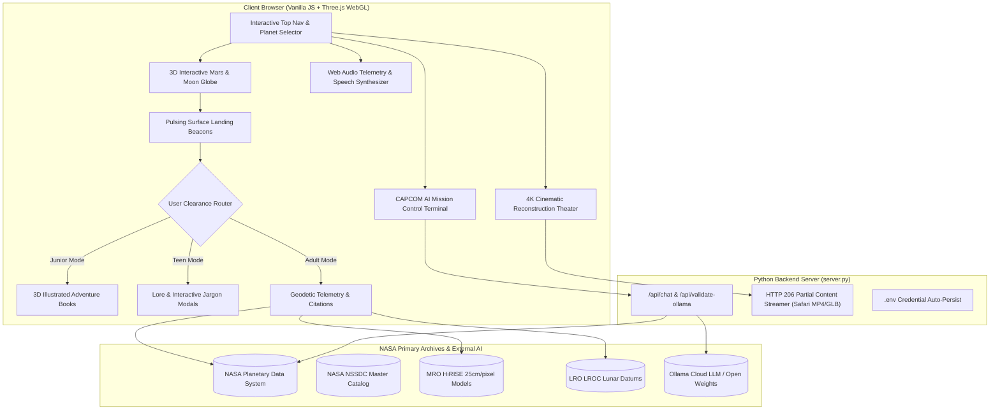

# 🛰️ ECHOES OF THE ORBIT // OFFICIAL PROJECT DOCUMENTATION
### *Preserving Planetary Exploration Heritage Across Mars & The Moon*
**NASA Space Apps Challenge 2026 — Comprehensive Project Overview & Critical Features Guide**

---

## 📑 TABLE OF CONTENTS
1. [Executive Summary](#1-executive-summary)
2. [The Challenge: Why This Project Exists](#2-the-challenge-why-this-project-exists)
3. [System Architecture & Data Flow](#3-system-architecture--data-flow)
4. [Critical Features: Deep Dive](#4-critical-features-deep-dive)
   - [Feature 1: Interactive 3D Planetary Globes](#feature-1-interactive-3d-planetary-globes-mars--the-moon)
   - [Feature 2: Multi-Generational Adaptive Clearance Engine](#feature-2-multi-generational-adaptive-clearance-engine)
   - [Feature 3: 4K Cinematic Reconstruction Theater](#feature-3-4k-cinematic-reconstruction-theater)
   - [Feature 4: CAPCOM AI Mission Control Terminal](#feature-4-capcom-ai-mission-control-terminal)
   - [Feature 5: Authentic Deep Space Telemetry & Audio Engine](#feature-5-authentic-deep-space-telemetry--audio-engine)
   - [Feature 6: Universal Accessibility & Assistive Learning](#feature-6-universal-accessibility--assistive-learning)
5. [NASA Data Pipeline & Scientific Integrity](#5-nasa-data-pipeline--scientific-integrity)
6. [Technology Stack & Performance Design](#6-technology-stack--performance-design)
7. [Impact & Future Vision](#7-impact--future-vision)

---

## 1. EXECUTIVE SUMMARY

**Echoes of the Orbit** is an interactive, multi-generational digital archaeology platform developed for the NASA Space Apps Challenge 2026. 

Since the dawn of the Space Age in 1969, humanity has landed over **200 metric tons** of robotic rovers, scientific landers, and crewed Apollo descent stages across the Martian and Lunar surfaces. In traditional textbooks and popular media, these inactive craft are all too often dismissed as cold, useless "space debris" or "graveyards."

**Echoes of the Orbit** completely reframes this narrative: **these machines are not space junk—they are living monuments and immortal pioneers of human curiosity.**

By fusing authentic **NASA Planetary Data System (PDS)** telemetry, **MRO HiRISE** sub-meter elevation models, and **LRO LROC** lunar datums with modern **WebGL 3D graphics** and an intelligent **CAPCOM AI assistant**, our platform brings the triumphs, final transmissions, and groundbreaking discoveries of these robotic pioneers back to life.

```
       "Not Space Junk. Robot Legends."
   Preserving 55+ years of human endeavor
       across the Red Planet and the Moon.
```

---

## 2. THE CHALLENGE: WHY THIS PROJECT EXISTS

### The Problem
* **The "Junk" Stigma:** Over 55+ years of exploration, deactivated hardware is frequently lumped into the category of "space junk," obscuring its profound scientific milestones.
* **The Imminent Threat of Surface Exploration:** As commercial spaceflight, the Artemis missions, and human Mars exploration ramp up, historic landing sites risk being inadvertently disturbed, contaminated, or stripped of their scientific context without international heritage awareness.
* **The One-Size-Fits-None Education Gap:** Most educational platforms either oversimplify space science (alienating older students and adults) or present impenetrable raw data tables (alienating children and young learners).

### Our Solution
A universally accessible platform that speaks to every audience in their native language:
* **Kids (<13)** experience the thrill through turnable 3D illustrated adventure books and space jokes.
* **Teens (13–18)** get authentic, unfiltered rover lore, Gen Z vibe checks, and interactive jargon decoders.
* **Researchers (18+)** explore verified geodetic coordinates, radioisotope power systems, and peer-reviewed citations.

---

## 3. SYSTEM ARCHITECTURE & DATA FLOW

The platform is designed around a lightweight, high-performance architecture requiring zero heavy framework bloat. It runs seamlessly across mobile, tablet, and desktop web browsers.



---

## 4. CRITICAL FEATURES: DEEP DIVE

### Feature 1: Interactive 3D Planetary Globes (Mars & The Moon)
* **What it does:** Renders high-fidelity, physically proportioned 3D celestial globes of both Mars and the Moon with realistic axial tilts, atmospheric glows, and bump-mapped topographical relief.
* **How it works:** Built using **Three.js (WebGL)** with custom shader uniforms for atmospheric scattering. The planets can be smoothly rotated, inspected, and zoomed using intuitive mouse drag or touch controls.
* **Surface Beacons:** Georeferenced landing coordinates are mapped onto the 3D sphere using spherical coordinate trigonometry:
  $$\begin{aligned} x &= R \cdot \cos(\text{lat}) \cdot \sin(\text{lng}) \\ y &= R \cdot \sin(\text{lat}) \\ z &= R \cdot \cos(\text{lat}) \cdot \cos(\text{lng}) \end{aligned}$$
  Clicking any pulsing beacon rotates the camera into a cinematic fly-in and immediately decodes that spacecraft's archive.

---

### Feature 2: Multi-Generational Adaptive Clearance Engine
Instead of forcing all users into a generic layout, the entire application dynamically re-architects its typography, tone, content depth, and interactive widgets based on the chosen explorer clearance:

#### 1. 🎒 Cadet Clubhouse (Level 01 // Ages <13)
* **3D Illustrated Adventure Books:** Interactive, page-turning comic book reader presenting each spacecraft's mission as a heroic saga with rich illustrations and chapter navigation.
* **Read-Aloud Voice Narrator:** Integrated text-to-speech that reads stories out loud using clear, natural, high-fidelity cadence.
* **Playful Sound Effects & Cosmic Jokes:** Cartoon boing effects, rocket boosts, and a dedicated cosmic space joke generator.

#### 2. ⚡ Teen Mission Control (Level 02 // Ages 13–18)
* **Unfiltered Rover Lore & "Vibe Checks":** Real-talk storytelling highlighting the human drama, grit, and unexpected improvisations of spaceflight (e.g., *Opportunity surviving 14 years on a 90-day warranty; Apollo 17 fixing a broken Moon car fender with gray duct tape*).
* **Interactive Jargon Explainer (`ⓘ` Buttons):** Rather than skipping difficult terms (like *HiRISE, APXS, radioisotope thermoelectric generator, X-band radio, planetocentric datums*), every technical term includes an interactive `ⓘ` button that opens a contextual modal explaining the concept through punchy, relatable analogies.

#### 3. 🔬 Research Archives (Level 03 // Ages 18+)
* **Sub-Meter Geodetic Datums:** Rigorous coordinates georeferenced to the **IAU 2000 Mars Planetocentric** and **LRO LROC Mean Earth/Polar Axis** coordinate systems.
* **Avionics & Payload Manifests:** Deep breakdowns of flight computers (e.g., *BAE RAD6000 32-bit RISC @ 20 MHz running VxWorks RTOS*), science suites (*Mössbauer spectrometers, Mini-TES, APXS*), and direct-to-Earth radio frequencies.
* **Peer-Reviewed Scientific Citations:** Direct hyperlinks to the **NASA Planetary Data System (PDS)** and **NSSDC Master Catalog**.

---

### Feature 3: 4K Cinematic Reconstruction Theater
* **What it does:** Provides high-definition continuous 3D camera fly-arounds of spacecraft resting in their off-world environments (*Opportunity in Endeavour Crater, InSight on Elysium Planitia, Apollo 11 Lunar Module at Tranquility Base, and the Lunar Roving Vehicle*).
* **Smooth Media Streaming:** Integrated with a custom **HTTP 206 Partial Content Range server** in `server.py`, ensuring instantaneous playback, video scrub, and fullscreen capabilities across all modern desktop and mobile browsers (including Safari and iOS).

---

### Feature 4: CAPCOM AI Mission Control Terminal
* **Dual-Engine Architecture:**
  1. **Built-in NASA Offline Knowledge Base:** 100% free, requiring zero external internet or credentials. Delivers instant, scientifically verified telemetry and historical answers.
  2. **Ollama Cloud Proxy:** Connects seamlessly to **Ollama Cloud API** (`https://ollama.com/api/chat` or local Ollama instances). Users can input their own API key in the in-app settings drawer (`⚙️`).
* **Persona Adaptation:** Automatically mirrors the active clearance level:
  * In *Junior Mode*, it acts as an encouraging cadet mentor.
  * In *Teen Mode*, it delivers witty, lore-packed receipts with zero corporate filter.
  * In *Adult Mode*, it responds with peer-reviewed authority and strict zero-slang scientific precision.
* **Live Connection Validator:** A built-in diagnostic test button (`💾 SAVE & TEST KEY`) immediately verifies external API keys, displaying clear visual feedback (`🟢 Connected: Ollama Cloud (llama3.2)` or `🔴 401 Unauthorized`) and persisting valid credentials to `.env`.

---

### Feature 5: Authentic Deep Space Telemetry & Audio Engine
* **Synthesized Audio Telemetry:** Uses the **Web Audio API** to generate real-time synthesized aerospace sounds:
  * Authentic **Apollo Quindar Tones** (2,525 Hz intro and 2,475 Hz outro beeps).
  * Deep Space Network radar pings and teletype data clicks.
  * Radio static and telemetry frequency blips.
* **Crystal-Clear Speech Synthesis:** Uses the **Web Speech API** configured with comfortable conversational defaults (`rate: 0.95`, `pitch: 1.0`, natural neural voices like *Samantha, Alex, Ava, Karen, Daniel*) to provide pleasant, easily understandable audio narration for storybooks and cadet prompts.

---

### Feature 6: Universal Accessibility & Assistive Learning
* **Inclusive by Design:** Designed from the ground up so that children and learners with disabilities can experience space exploration barrier-free.
* **Assistive Features:**
  * **Screen-Reader Ready:** Semantic HTML5 landmarks, explicit ARIA attributes, and keyboard-navigable dialogs (`Escape` to close).
  * **Audio First Alternatives:** Full voiceover narration for all comic book content and mission lore.
  * **High-Contrast Typography:** Neon cyan and gold accents on deep space navy backgrounds, optimized for readability and dyslexia-friendly contrast ratios.
  * **Cognitive Load Optimization:** Complex concepts are broken down into bite-sized analogies via the `ⓘ` lexicon system.

---

## 5. NASA DATA PIPELINE & SCIENTIFIC INTEGRITY

Every spacecraft profile, coordinate, and telemetry datapoint in **Echoes of the Orbit** is sourced directly from open NASA mission archives:

| Mission / Asset | NASA Archive Source | Dataset Utilized | Verified Scientific Contribution |
| :--- | :--- | :--- | :--- |
| **Opportunity (MER-B)** | NASA PDS Geosciences Node | Athena Science Payload Archive; Sol-by-Sol drive logs | Hematite concretions ("blueberries") proving sustained acidic liquid water in Martian history; 45.16 km off-world marathon record. |
| **Spirit (MER-A)** | NASA PDS Geosciences Node | Athena APXS & Mini-TES Spectra (Home Plate) | 90% pure opaline silica uncovered by seized right-front wheel; confirmed ancient hydrothermal hot springs. |
| **InSight Lander** | NASA PDS Geosciences Node | SEIS Mars Seismological Catalog | Recorded 1,318 extraterrestrial marsquakes; mapped liquid metallic core radius to 1,830 ± 40 km. |
| **Ingenuity Helicopter** | NASA JPL Mars Missions | Flight Log Archive (Flights 1–72) | First powered controlled aerodynamic flight on another planet; 72 sorties logged across 128.8 minutes aloft. |
| **Apollo 11 LRRR** | NASA Planetary Data System | Lunar Laser Ranging Experiment Archive | Continuous 55-year optical retroreflection; proved Moon is spiraling away from Earth at 3.82 cm/year. |
| **Apollo 17 LRV** | NASA Apollo Lunar Surface Journal | LRV-003 Traverse Maps & Field Telemetry | 35.9 km lunar roving traverse; documented field-expedient fender repair using maps and gray duct tape. |
| **Orbital Imagery** | NASA MRO HiRISE & CTX | 25 cm/pixel Digital Elevation Models | IAU 2000 Mars Planetocentric surface elevation and landing site verification. |
| **Lunar Reconnaissance** | NASA LRO LROC Archive | Narrow Angle Camera (0.5 m/pixel) | Exact Lunar Module descent stage coordinates relative to Mean Earth/Polar Axis. |

---

## 6. TECHNOLOGY STACK & PERFORMANCE DESIGN

* **Frontend:** Vanilla JavaScript (ES6 Modules), HTML5, CSS3. Zero frontend framework overhead (no React/Angular/Vue dependencies), resulting in sub-second initial load times and smooth 60 FPS WebGL rendering.
* **3D Engine:** Three.js (WebGL) with OrbitControls, custom shader uniforms, and GLTF/GLB loader.
* **Backend:** Python 3 (`http.server` + `socketserver`) providing:
  * Static file delivery with automated MIME-type resolution.
  * HTTP 206 Partial Content Range support for Safari MP4 video streaming.
  * Safe credential persistence into `.env` (automatically gitignored).
  * Secure server-side proxy for external Ollama Cloud LLMs.
* **Audio:** Web Audio API (real-time procedural oscillator synthesis) & Web Speech API.

---

## 7. IMPACT & FUTURE VISION

### 1. Planetary Cultural Heritage Preservation
Before upcoming crewed missions (Artemis, commercial lunar landers, human Mars missions) begin heavy industrial and exploration operations, **Echoes of the Orbit** establishes a digital, publicly accessible register of humanity's off-world cultural heritage. It promotes international adherence to **COSPAR planetary protection** and historic site preservation guidelines.

### 2. Multi-Generational STEM Inspiration
By bridging the gap between colorful comic books for elementary students, relatable lore for teenagers, and peer-reviewed telemetry for university researchers, the platform serves as an inclusive pipeline inspiring the next generation of aerospace engineers, astrophysicists, and planetary scientists.

### 3. Expansion Roadmap
* **Expanding Probes:** Incorporating outer-solar-system pioneers (*Voyager 1 & 2, Cassini, Huygens on Titan, Venera on Venus, and New Horizons*).
* **Tactile & Haptic Accessibility:** Developing haptic feedback profiles for mobile and VR controllers, allowing visually impaired users to "feel" lunar craters and Martian topography.
* **Community Telemetry Feeds:** Enabling citizen scientists and students to contribute educational illustrations and translations for regional classrooms worldwide.

---

```
             ★ ECHOES OF THE ORBIT ★
   "Humanity touched the stars because these
        brave machines dared to lead the way."
```
