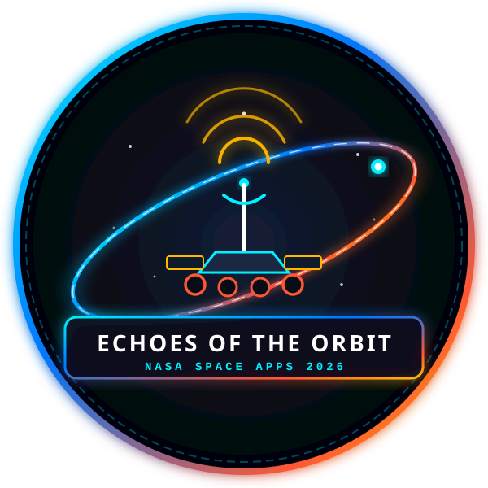
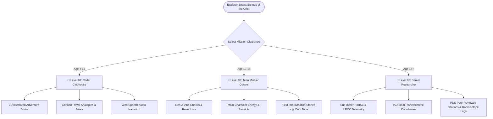

# 📡 ECHOES OF THE ORBIT
### *Abandoned but not Forgotten: Storytelling about NASA's Discarded Equipment on the Moon and Mars*
**NASA Space Apps Challenge 2026 — Global Challenge Submission**

<p align="center">
  
</p>

<p align="center">
  <a href="#-live-interactive-website"></a>
  <a href="https://www.spaceappschallenge.org/2026/challenges/nasas-discarded-equipment-storytelling/"></a>
  
  
</p>

---

## 🌐 Live Interactive Website & Submission Links

> [!IMPORTANT]
> **Click below to explore the live, interactive deployment of Echoes of the Orbit:**
>
> 🚀 **Live Interactive Website:** **`https://YOUR_GITHUB_USERNAME.github.io/YOUR_REPOSITORY_NAME/`**  
> *(Replace with your deployed GitHub Pages, Vercel, or custom domain URL)*
>
> 📦 **GitHub Repository:** **`https://github.com/YOUR_GITHUB_USERNAME/YOUR_REPOSITORY_NAME`**  
> 🎬 **Video Demonstration Walkthrough:** [VIDEO_DEMO_SCRIPT.md](VIDEO_DEMO_SCRIPT.md)  
> 📊 **Project Slide Deck:** [Space Apps Presentation_Blr 2026_Project submission.pdf](Space%20Apps%20Presentation_Blr%202026_Project%20submission.pdf)  
> 🛰️ **NASA Archival Citations & Bibliography:** [NASA_RESOURCES.md](NASA_RESOURCES.md)

---

## 🎯 NASA Challenge Overview
* **Challenge:** [*Abandoned but not Forgotten: Storytelling about NASA's Discarded Equipment on the Moon and Mars*](https://www.spaceappschallenge.org/2026/challenges/nasas-discarded-equipment-storytelling/)
* **Problem Statement:** Over more than half a century of lunar and planetary exploration, humanity has left over 200 metric tons of technological hardware—probes, rovers, landers, descent stages, and scientific instruments—across the Moon and Mars. Most textbooks dismiss them as "cold debris" or "space junk."
* **Our Solution:** **Echoes of the Orbit** resurrects these inactive robotic pioneers as living monuments and immortal storytellers. Using authentic NASA telemetry, interactive 3D planetary globes, multi-generational storytelling modes, and a direct CAPCOM AI conversational terminal, users decode the final transmissions and groundbreaking scientific legacy of humanity's silent explorers.

---

## 👥 Multi-Generational Clearance Levels

To make space exploration engaging for all ages without dumbing down the science, **Echoes of the Orbit** introduces three distinct interactive clearances:



1. **🎒 Cadet Explorer (Kids < 13):**
   * Turnable 3D Illustrated Comic & Storybooks with full-page spreads.
   * Playful sound effects, cartoon spring bounces, and cosmic space riddles.
   * Clear, natural voiceover narration for young readers.
2. **⚡ Mission Specialist (Teens 13–18):**
   * Unfiltered rover lore, Gen Z vibe checks, and main character energy ("Oppy running a 14-year marathon on a 90-day warranty, no cap").
   * Interactive jargon explainer (`ⓘ` badges) breaking down complex telemetry into intuitive analogies.
3. **🔬 Senior Researcher (Adults 18+):**
   * Full scientific precision: zero slang, comprehensive flight logs, and geodetic coordinate datums.
   * Direct deep-links to the **NASA Space Science Data Coordinated Archive (NSSDCA)** and **NASA Solar System Treks**.

---

## 🚀 Key Features & Technological Pillars

### 1. Interactive 3D Planetary Exploration (WebGL & Three.js)
* High-definition 3D globes for **Mars** and **The Moon** featuring bump mapping, atmospheric Fresnel glow, and rotational drag controls.
* Interactive pulsing coordinate beacons marking exact historical landing sites. Clicking any beacon flies the camera directly into that spacecraft's dossier or storybook.

### 2. 4K Cinematic Reconstruction Theater
* Continuous 3D fly-around reconstructions generated from orbital imagery for **Opportunity (MER-B)**, **InSight Lander**, **Apollo 11 "Eagle" Descent Stage**, and the **Apollo Lunar Roving Vehicle (LRV)**.
* Integrated audio unmuting, mission quotes, and fullscreen playback.

### 3. Dual-Mode CAPCOM AI Comms Console
* **Built-in NASA Intelligence Engine:** 100% offline, free, and instant fallback answering questions on martian geology, Apollo duct-tape repairs, hematite blueberries, and seismology.
* **Ollama Cloud & Local LLM Integration:** Full proxy supporting **Ollama Cloud** (`llama3.2`, `mistral`, `gemma2`) with in-app API key validation, live status indicators (`🟢 Active: Ollama Cloud`), and hot `.env` reloading.

### 4. Interactive LIDAR Blueprint-to-Render Scanner
* Interactive split-screen slider allowing explorers to wipe between technical blueprint edge-detection schematics (powered by dynamic SVG convolution filters) and textured 3D renders.

### 5. Procedural Audio Telemetry System
* Web Audio API synthesized soundscapes: Apollo Quindar tone bursts (2524 Hz), carrier wave radio static, teletype data feeds, and high-frequency radar pulses.
* Crystal-clear Web Speech API synthesis configured with natural, human cadence (`rate: 0.95`, `pitch: 1.0`).

---

## 🛰️ NASA Archival Datasets & Resources Integrated

Every spacecraft record in **Echoes of the Orbit** is cross-referenced with official NASA open science archives:

| Mission / Equipment | Designation | NSSDC ID | Coordinate Datum | Primary NASA Source |
| :--- | :--- | :--- | :--- | :--- |
| **Opportunity (MER-B)** | Mars Exploration Rover B | `2003-032A` | -1.95° S, 354.47° E | [NASA NSSDCA](https://nssdc.gsfc.nasa.gov/nmc/spacecraft/display.action?id=2003-032A) & MRO HiRISE |
| **Spirit (MER-A)** | Mars Exploration Rover A | `2003-027A` | -14.57° S, 175.48° E | [NASA NSSDCA](https://nssdc.gsfc.nasa.gov/nmc/spacecraft/display.action?id=2003-027A) & MER Athena Logs |
| **InSight Lander** | Mars Geophysical Laboratory | `2018-042A` | 4.50° N, 135.62° E | [NASA PDS Geosciences](https://pds-geosciences.wustl.edu/) & SEIS Catalog |
| **Ingenuity Mars Helicopter** | Technology Scout Drone | `MARS-INGENUITY` | 18.44° N, 77.45° E | [NASA JPL Flight Logs](https://mars.nasa.gov/technology/helicopter/) |
| **Apollo 11 LM Stage & LRRR** | *Eagle* Descent Stage | `1969-059C` | 0.674° N, 23.473° E | [Apollo Lunar Surface Journal](https://www.nasa.gov/history/alsj/) & LRO LROC |
| **Apollo 15 Lunar Rover** | LRV-001 Electric Buggy | `1971-063C` | 26.13° N, 3.63° E | [NASA NSSDCA LRV](https://nssdc.gsfc.nasa.gov/nmc/spacecraft/display.action?id=1971-063C) |
| **Apollo 17 LRV & ALSEP** | LRV-003 & Science Package | `1972-096C` | 20.19° N, 30.77° E | [NASA SP-235 Science Report](https://ntrs.nasa.gov/) |
| **Surveyor 3** | Soft Lunar Lander | `1967-035A` | -3.01° S, 336.58° E | [NASA Apollo 12 Inspection](https://www.nasa.gov/mission_pages/apollo/missions/apollo12.html) |
| **Viking 1 Lander** | Chryse Planitia Station | `1975-075C` | 22.48° N, 312.05° E | [NASA PDS Viking Node](https://pds.nasa.gov/) |

*For complete details, see [NASA_RESOURCES.md](NASA_RESOURCES.md).*

---

## 💻 How to Run Locally

### Option 1: Direct Web Browser (Pure Static)
Because all core 3D globes, storybooks, and NASA intelligence run in client-side ES6 JavaScript, you can host or preview the application immediately without installing dependencies:
```bash
# Using Python's built-in server
python3 -m http.server 8000
```
Open **`http://localhost:8000`** in any web browser.

### Option 2: Full-Stack Mode with Ollama Cloud AI & Safari 206 Streaming
To enable real-time Ollama Cloud LLM generation and partial-range MP4 video streaming:
```bash
# 1. Start the backend server
python3 server.py

# 2. Open in your browser
http://localhost:8000
```

#### Configuring Ollama API Key:
1. Open [.env.example](.env.example), save a copy as `.env`, and add your key:
   ```env
   OLLAMA_API_KEY="your_ollama_cloud_key"
   OLLAMA_MODEL="llama3.2"
   ```
2. Or click the **`🤖 CAPCOM AI`** button on the website, click **`⚙️` (Settings)**, paste your key, and click **`💾 SAVE & TEST KEY`**!

---

## 📁 Repository Structure

```
githubuplode/
├── index.html                  # Core interactive single-page web platform
├── server.py                   # Python server, HTTP 206 video streamer, & Ollama proxy
├── css/
│   └── styles.css              # Cyber-telemetry HUD styling & responsive layouts
├── js/
│   ├── app.js                  # Master application orchestrator & routing
│   ├── chatbot.js              # CAPCOM AI console with live key validation
│   ├── planetView.js           # Three.js 3D Mars & Moon interactive globes
│   ├── storybook.js            # Turnable 3D illustrated comic book engine
│   ├── audioTelemetry.js       # Web Audio API procedural sound synthesizer
│   ├── effect.js               # Space-time canvas interactive warp & bulge
│   └── threeHelper.js          # Three.js utility shaders & coordinate math
├── data/
│   ├── equipmentData.js        # NASA archival hardware catalog (13 spacecraft)
│   └── glossaryData.js         # Interactive Jargon Explainer dictionary
├── assets/
│   ├── models/                 # 3D GLB spacecraft models (Opportunity, InSight, etc.)
│   ├── Videos/                 # 4K continuous cinematic orbit fly-around MP4s
│   ├── renders/                # High-resolution photographic renders
│   ├── mars_texture.jpg        # NASA MRO/CTX Mars global surface texture
│   ├── moon_texture.jpg        # NASA LRO/LROC Lunar surface texture
│   └── logo.svg                # Vector mission badge & patch
├── kids/, teen/, adult/        # Deep-link routing entry points for web hosting
├── .env.example                # Safe environment configuration template
├── .gitignore                  # Blocks private API keys (.env) from git commits
├── NASA_RESOURCES.md           # Master bibliography & scientific citations
├── VIDEO_DEMO_SCRIPT.md        # Video demonstration presentation script
└── Space Apps Presentation...  # Presentation slide deck for judges
```

---

## 🏆 Presentation Highlights for NASA Judges
* **Challenge Addressed:** [Abandoned but not Forgotten: Storytelling about NASA's Discarded Equipment on the Moon and Mars](https://www.spaceappschallenge.org/2026/challenges/nasas-discarded-equipment-storytelling/)
* **Emotional Resonance:** Transforms inanimate metal relics into heroic pioneers who endured extreme cosmic environments to advance human knowledge.
* **Accessibility:** Adaptable clearance interface tailors vocabulary and depth from elementary students to professional astrophysicists.
* **Open Science & Data Stewardship:** 100% compliant with NASA open-data policies, providing clickable citations to NASA NSSDCA, NASA Treks, and JPL archives.

*Created for the NASA Space Apps Challenge 2026.*
